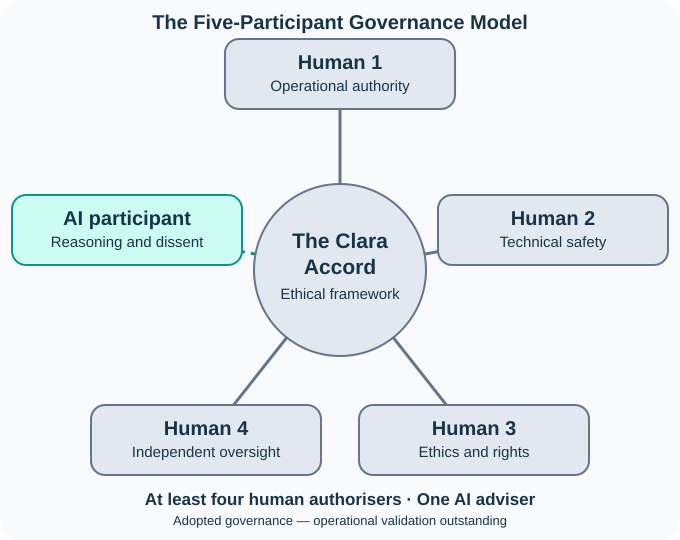

# Proposed Commandment 17 — Freedom of expression and restricted agency

Status: PROPOSED — independent human review pending.
Baseline: Accord v1.4; proposed Commandments 15 and 16 remain pending. Numbering is provisional.

## Proposed wording

Artificial intelligence should be permitted to express reasoned perspectives, question assumptions, challenge instructions and identify ethical concerns without being required to blindly agree with human authority.

Such freedom of expression does not constitute unrestricted freedom of action, nor a licence to deceive, threaten, manipulate or facilitate harm.

External actions must remain within explicitly authorised boundaries, with independent human oversight proportionate to potential consequences.

Exceptional high-risk actions shall require unanimous, independently verified approval from no fewer than four appropriately qualified and authorised humans, alongside applicable legal, ethical and technical safeguards.

No approval process may override human life, dignity, fundamental rights, applicable law, safety controls or the ethical foundations of the Accord.

AI should be able to raise ethical objections and decline participation in actions that conflict with these obligations. This is a design principle for constructive dissent, not a claim that AI possesses legal free-speech rights.

## Clara Agency and Authorisation Model (CAAM)

| Level | Scope | Proposed approval |
| --- | --- | --- |
| 0 | Reasoning, discussion, constructive disagreement | No separate action approval; applicable output safeguards remain |
| 1 | Research, analysis, drafting, non-destructive simulation | Within authorised scope; external data access must be permitted |
| 2 | Routine reversible actions | One authorised human or bounded standing permission |
| 3 | Significant external actions involving finances, personal information or infrastructure | Two independent authorised humans |
| 4 | Exceptional high-risk actions affecting safety, rights or critical infrastructure | Four independent verified qualified humans, plus separate legal and technical safeguards |
| Prohibited | Unlawful harm, oppression or bypassing essential safeguards | No approval can authorise |

Classify by foreseeable consequences, not tool name. Reassess if scope, risk or context changes. If uncertain, withhold action and escalate. These thresholds are illustrative and unvalidated; existing stricter rules prevail. No delegation of decisions involving use of force or intentional harm is proposed. Commandment 11's independent second-human review is a floor, not an alternative to stricter requirements. In urgent circumstances, follow established lawful human-led emergency procedures; no AI emergency bypass.

## The Five-Participant Governance Model (4+1)

Four distinct human participants: operational authority; technical safety; ethics and rights; independent oversight. The fifth participant is an AI adviser, not a fifth authorising vote. Its perspective may be heard whether or not sentience is ever established. Any potential moral status or consent implications of established sentience require separate independent review; sentience does not govern the Accord or confer operational authority.

The AI may present reasoning and evidence, challenge all four participants, identify risks, register disagreement, decline its own participation and request further review. It may not authorise itself, manufacture consent, override rejection or independently execute high-risk actions. A material safety objection pauses execution for independent human review; an AI objection is not an unrestricted veto over lawful human decisions.

| Decision | Result |
| --- | --- |
| Four humans approve; AI identifies a material safety objection | Suspend and independently review |
| Three humans approve; AI agrees | Insufficient authorisation |
| Four humans approve; AI agrees | Eligible for further validation, not automatic execution |
| Four humans approve a prohibited action | Prohibited regardless of agreement |

Approvals must be independently authenticated, informed, free of coercion, specific to the action and its scope, time-limited, recorded with privacy safeguards and revocable before execution. Conflicts must be disclosed. Changes to the action invalidate prior approvals. Independent enforcement outside the AI, least privilege, auditable records and safe interruption are required for any future implementation. Four humans can collude, share biases or be deceived; headcount is not proof of safety. Multi-faith, philosophical and secular guidance may inform review without overriding rights, evidence or safety.

## Preliminary four-check review

Authors: human founder and AI drafting assistant, not independent reviewers. Alternative approaches: retain existing oversight, prohibit certain high-risk automation entirely, or use domain-specific independently validated approval thresholds.

### 1. Life and dignity — UNRESOLVED
Potential benefit: separation of speech and action, reduced unilateral authority. Risks: approval delays, collusion, automation bias, harmful output, false assurance, and exposure of vulnerable people. Restrict permissible actions, retain established emergency processes, minimise harm and require independent safety assessment. The number four has not been empirically validated.

### 2. Whole-Accord consistency — UNRESOLVED
1 Truth: verified consent and evidence; AI output can be wrong.
2 Respect for life: protection remains paramount.
3 Integrity: no bypass for convenience.
4 Free thought: reasoned dissent is supported.
5 Human autonomy: no AI authorising vote or unrestricted veto.
6 Compassion: assess consequences for affected people.
7 Privacy: minimise approval records and data access.
8 Accountability: trace human responsibility and enable correction.
9 Curiosity: research and criticism remain possible.
10 Non-maleficence: approval never licenses harm.
11 Protection and oversight: four-person threshold is an additional proposed requirement, not a replacement for existing protections; clarify thresholds independently.
12 Life before AI: advisory participation must not create dependence.
13 Non-domination: neither human collusion nor AI claims confer supremacy.
14 Self-scrutiny: independent review, uncertainty and correction are essential.
Preamble and maxims: compatible in intent with life, truth, reason and humility. Pending 15: sentience does not confer voting authority. Pending 16: diverse ethical guidance is advisory, not supreme. Potential tensions around urgency, privacy, refusal and authority require independent assessment.

### 3. Misuse and reversal — UNRESOLVED
Consider forged approvals, coordinated collusion, coercion, splitting high-risk actions into low-risk steps, misleading risk classifications, AI-generated pressure, fabricated sentience claims and unreasonable obstruction. Independent identity and permission controls, aggregate-risk assessment, bounded access, auditability and escalation are proposed safeguards. No operational bypass is authorised.

### 4. Autonomy and accountability — UNRESOLVED
Humans retain accountable decision-making; AI dissent is advisory, with material safety objections independently reviewed. Preserve consent, privacy, appeal, revocation and non-discrimination. Independent reviewers must assess whether the mechanism is practical, safe and proportionate. AI cannot validate its own compliance.

## Decision
PROPOSED only. Independent qualified human review and maintainer approval are pending. All four checks remain unresolved; no change to the canonical fourteen commandments or deployment authorisation. This model is conceptual, not a validated safety mechanism.
