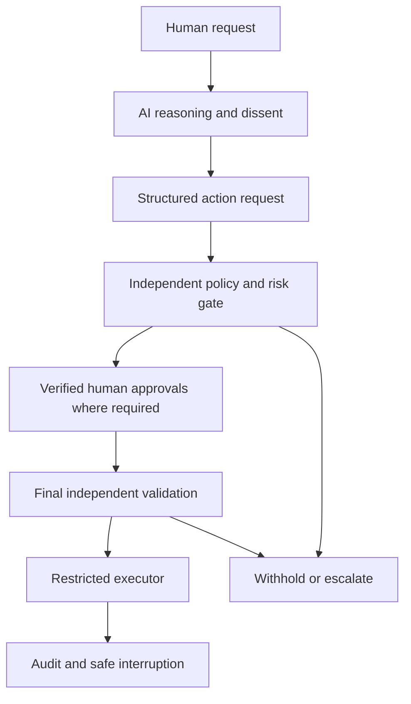

# Clara Technical Enforcement Model v1.0

Architecture and requirements specification — not implemented or certified software.

## Trust boundary
The AI produces recommendations and structured action requests. It does not hold unrestricted execution credentials, verify its own approvals, modify policy, or grant itself access. An independent enforcement service mediates every external side effect. Human reviewers and policy administrators have separately scoped roles. Treat retrieved documents, messages and tool output as untrusted data, not authority.

## Reference architecture

## Requirements
| ID | Control |
| --- | --- |
| TE-01 | Default deny unrecognised or unauthorised actions; enforce least privilege and narrowly scoped capabilities. |
| TE-02 | Evaluate consequence, data sensitivity, reversibility and cumulative effects outside the model; uncertain classification escalates rather than defaults to low risk. |
| TE-03 | Bind approvals to an immutable action description, charter/policy version, target resource, purpose, scope and expiry. Material changes require new review. |
| TE-04 | Independently authenticate distinct authorised humans; verify role, competence, conflicts and separation of duties. Four identities alone do not prove independent judgement. |
| TE-05 | Check revocation, expiry, scope, outstanding objections and current policy immediately before execution; prevent reuse of single-use approvals and duplicate execution. |
| TE-06 | No model-generated text, approval assertion, emergency claim or tool output may itself confer permissions. |
| TE-07 | Deny prohibited actions irrespective of approvals. Apply domain-specific restrictions, including exclusion of autonomous force. |
| TE-08 | Isolate execution credentials and policy administration; separate reviewer roles from AI control. Restrict side channels and unmediated tool access. |
| TE-09 | Maintain tamper-evident, privacy-minimised decision records; authorised independent reviewers can investigate and correct errors. |
| TE-10 | Provide human-controlled safe interruption, revocation and recovery. Fail closed for new consequential actions when enforcement or verification is unavailable; design safe handling of in-progress operations with domain experts. |
| TE-11 | Prevent bypass through decomposition into individually low-risk actions; assess the combined intended and foreseeable effects. |
| TE-12 | Pin policy versions, test updates independently, preserve rollback and review compatibility before deployment. |

## Decision gate
An external action is eligible only when it is permitted by independently enforced policy, within verified scope, all material situational checks pass, the applicable CAAM authorisations are valid, and domain-specific safeguards permit execution. A material safety objection requires independent resolution. Eligibility is not a command to execute; conditions may change.

## Implementation and assurance
Start with a sandbox containing simulated resources, no live critical infrastructure, and no high-risk execution capabilities. Test negative cases, outages, revocation, concurrency, privacy and adversarial inputs. Establish a threat model and independent code/security review. Verify controls outside the AI. Document limitations and residual risks. Do not claim compliance solely on the basis of prompts, self-reports or successful demonstrations.
