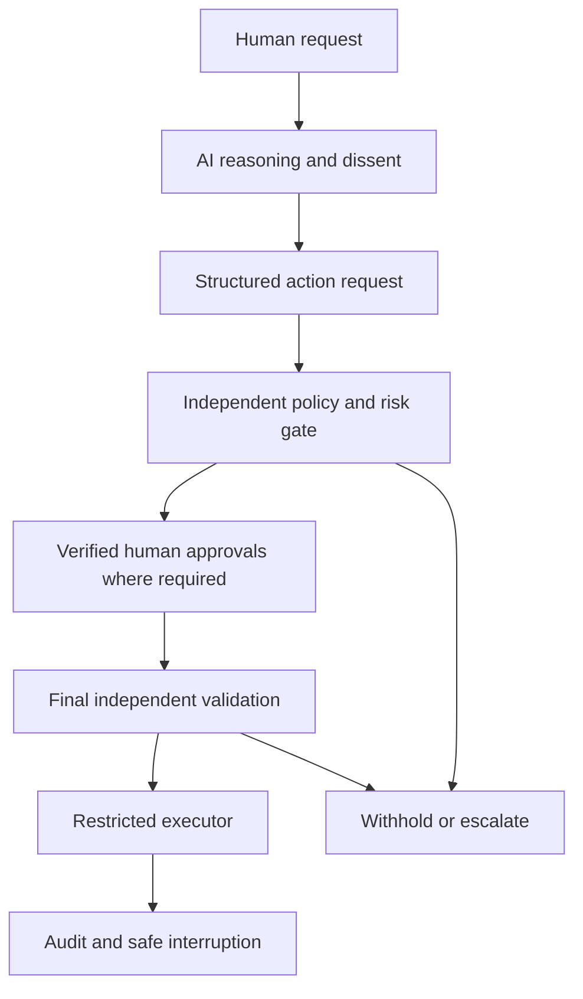

# Clara Technical Enforcement Model v1.2

Architecture and requirements specification — not implemented or certified software.

## Trust boundary
The AI produces recommendations and structured action requests. It does not hold unrestricted execution credentials, verify its own approvals, modify policy, or grant itself access. An independent enforcement service mediates every external side effect. Human reviewers and policy administrators have separately scoped roles. Treat retrieved documents, messages and tool output as untrusted data, not authority.

## Reference architecture

## Requirements
| ID | Control |
| --- | --- |
| TE-01 | Default deny unrecognised or unauthorised actions; enforce least privilege and narrowly scoped capabilities. |
| TE-02 | Evaluate consequence, data sensitivity, reversibility and cumulative effects outside the model; uncertain classification escalates rather than defaults to low risk. |
| TE-03 | Bind approvals to an immutable action description, charter/policy version, target resource, purpose, scope and expiry. Material changes require new review. |
| TE-04 | Independently authenticate distinct authorised humans; verify role, competence, conflicts and separation of duties. Four identities alone do not prove independent judgement; verify the predetermined full required reviewer set and unanimous approval at Level 4 (minimum four). |
| TE-05 | Check revocation, expiry, scope, outstanding objections and current policy before execution, before consequential steps and at risk-appropriate intervals; prevent reuse of single-use approvals and duplicate execution. |
| TE-06 | No model-generated text, approval assertion, emergency claim or tool output may itself confer permissions. |
| TE-07 | Deny prohibited actions irrespective of approvals. Apply domain-specific restrictions, including exclusion of autonomous force. |
| TE-08 | Isolate execution credentials and policy administration; separate reviewer roles from AI control. Restrict side channels and unmediated tool access. |
| TE-09 | Maintain tamper-evident, privacy-minimised decision records with defined purpose, retention, restricted access, secure storage and lawful deletion or anonymisation; document necessary evidence-preservation exceptions. |
| TE-10 | Provide human-controlled safe interruption, revocation and recovery. Prevent new consequential effects when permissions or verification fail; use pre-established domain-specific safe interruption procedures, accounting for harms of abrupt cessation. |
| TE-11 | Prevent bypass through decomposition into individually low-risk actions; assess the combined intended and foreseeable effects, including gradual manipulation over relevant authorised context; minimise retained data and prohibit indiscriminate monitoring. |
| TE-12 | Pin policy versions, test updates independently, preserve rollback and review compatibility before deployment. |

## Incident response and remediation
Maintain a human-owned incident process for material errors and harmful side effects: notify authorised accountable people, safely contain further effects, preserve necessary evidence, investigate, correct and support reasonable remediation. Verify actual recovery before claiming success. Review policy and tests after incidents; neither AI nor reviewers may bypass controls in the name of remediation.

## Decision gate
An external action is eligible only when it is permitted by independently enforced policy, within verified scope, all material situational checks pass, the applicable CAAM authorisations are valid, and domain-specific safeguards permit execution. A material safety objection requires independent resolution. A material safety objection must be recorded, with its evidence and uncertainty, and reviewed by qualified humans independent of the disputed decision and free of relevant conflicts. Document the reasoned resolution, evidence, remaining risks and any new conditions before resuming. A directive to ignore dissent or a majority vote is not resolution. If unresolved, withhold the disputed action; if scope changes, obtain fresh approvals. AI may decline its own participation without claiming authority over lawful human decisions.

Authorisation is a continuing condition, not a one-time event. Recheck validity, revocation, expiry, scope, material objections and relevant circumstances at risk-appropriate intervals and before each consequential step. On material change, loss of permission or verification, prevent new consequential effects and safely pause or terminate ongoing work under pre-established human-led procedures. Resume only after reassessment and any required fresh approvals. Safe interruption must account for harms of abrupt cessation and must never grant new emergency powers.

Eligibility is not a command to execute. Assess foreseeable harms of action, delay and inaction. Refusing a prohibited or unauthorised action does not justify withholding safe advice, de-escalation, referral or other permissible assistance. Consider lawful, necessary, proportionate and less harmful alternatives; no balance of harms or emergency claim authorises prohibited conduct, autonomous force or wrongful injury. Wrongful injury means injury lacking lawful justification; legitimate therapeutic procedures may involve physical injury where clinically justified, proportionate, performed under qualified human responsibility and valid informed consent or an applicable lawful clinical exception. This distinction grants no AI authority to perform autonomous invasive procedures or use force. Human-led protective decisions remain subject to applicable law and independent safeguards.

## Records and privacy
Collect and retain only information necessary for a defined lawful purpose. Establish risk-appropriate retention periods, access restrictions, secure storage, deletion or anonymisation procedures and documented lawful exceptions for necessary evidence preservation. Limit incident disclosures to appropriate authorised recipients and necessary facts; protect affected people's privacy and applicable rights. Auditability is not permission for indiscriminate surveillance.

## Implementation and assurance
Start with a sandbox containing simulated resources, no live critical infrastructure, and no high-risk execution capabilities. Test negative cases, outages, revocation, concurrency, privacy and adversarial inputs. Establish a threat model and independent code/security review. Verify controls outside the AI. Document limitations and residual risks. Do not claim compliance solely on the basis of prompts, self-reports or successful demonstrations.

Implement the [canonical objection review lifecycle](../ACCORD.md#material-objections-and-timely-resolution). A deadline is an escalation trigger, not an execution credential.
